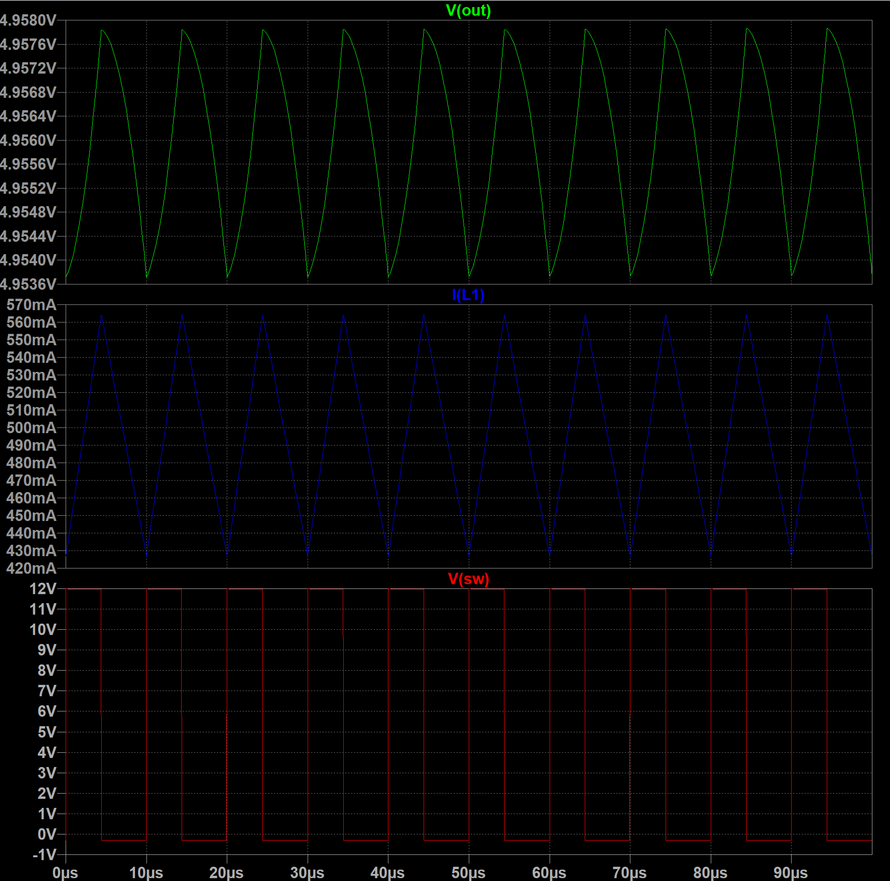
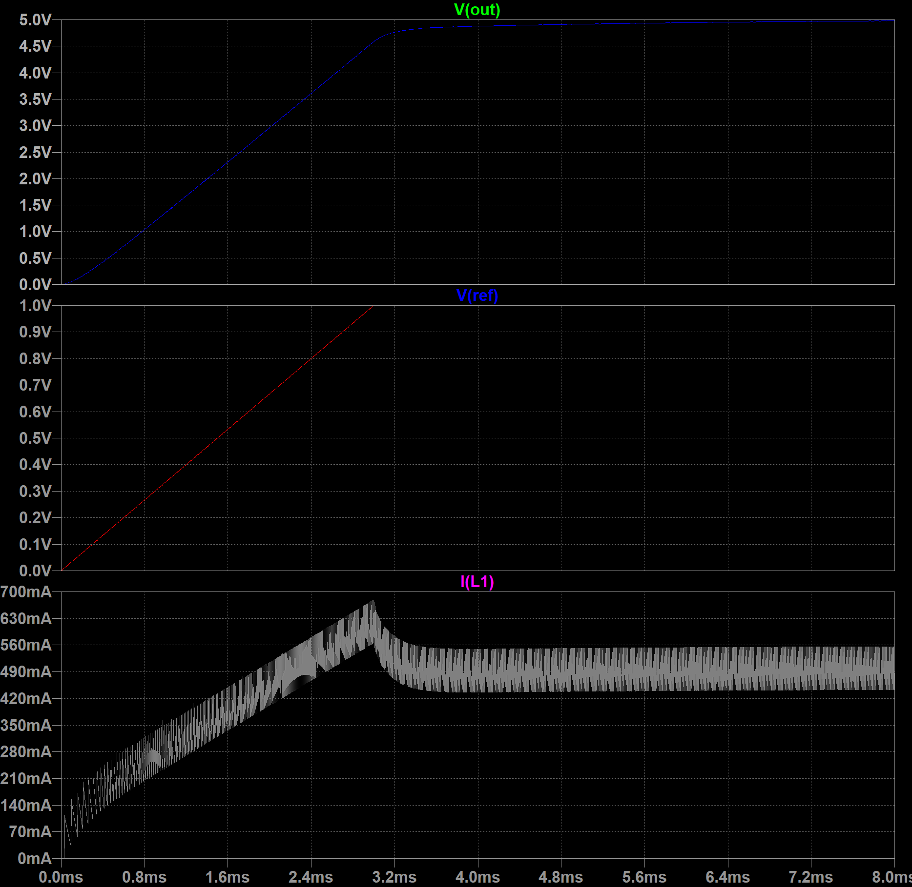
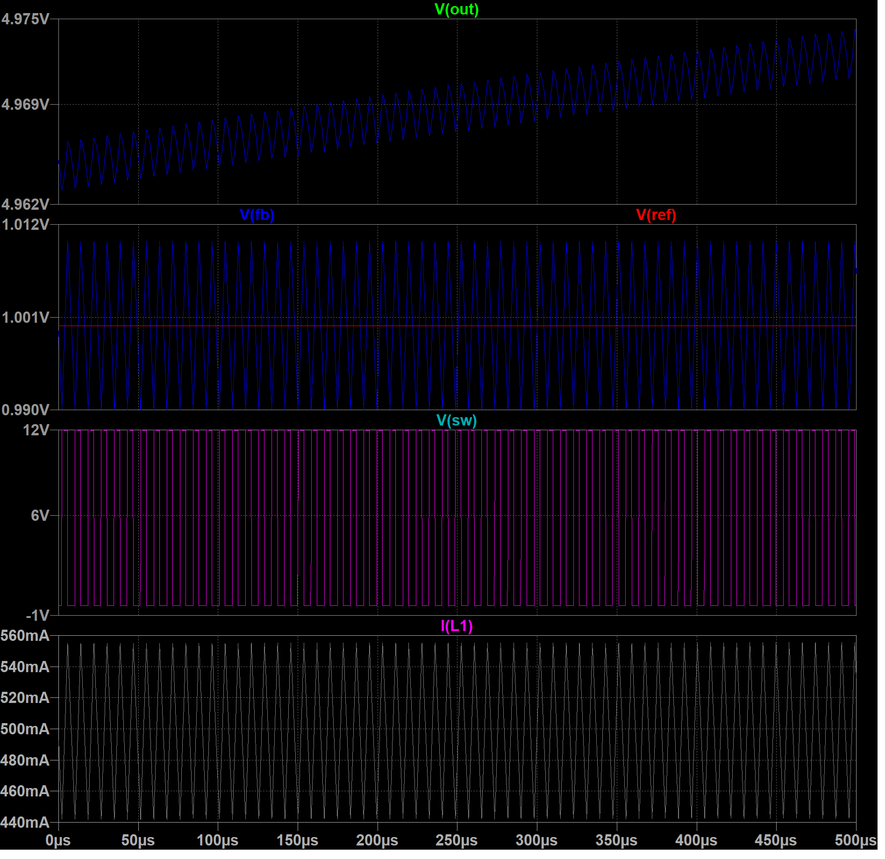
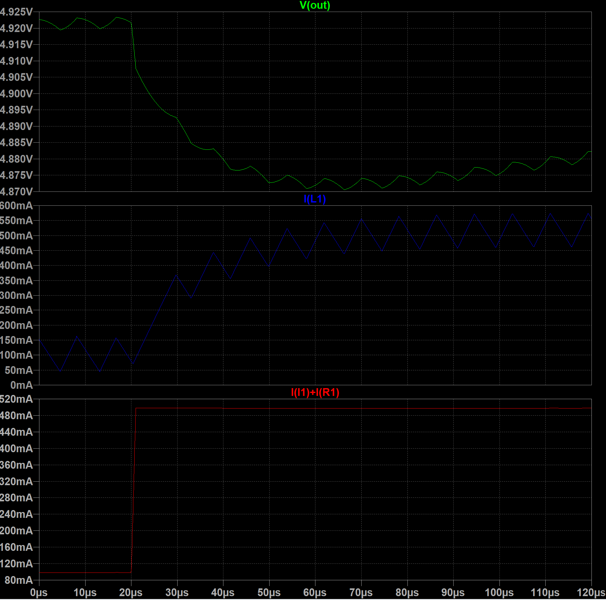
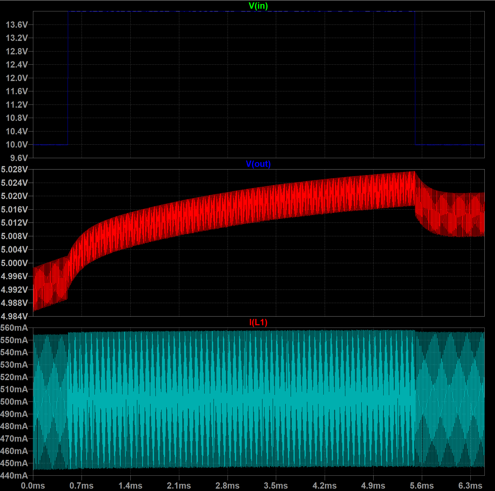

# Bang-Bang Controlled Buck Converter

Design, LTspice simulation, and PCB implementation of a closed-loop nonsynchronous buck converter using **bang-bang (hysteretic) voltage control** with **ripple injection**.

This project was created to put into practice and further develop the power-electronics knowledge I have gained throughout my professional career. Starting from first principles, I designed the buck-converter power stage, implemented a hysteretic feedback controller, and verified its operation in LTspice.

The next stage of the project is to replace the remaining generic simulation components with selected real components, design the PCB, and compare measured hardware behavior against the simulation.

The main objective is to demonstrate how a simple nonlinear controller can regulate the output voltage **without an error amplifier, compensation network, PWM ramp, or fixed-frequency PWM modulator**.

---

## 1. Project Objectives

- Design a DC-DC buck converter from first principles
- Calculate the required inductor and capacitors
- Simulate the power stage in LTspice
- Understand MOSFET, diode, inductor, and capacitor behavior
- Implement a bang-bang / hysteretic controller
- Define upper and lower switching thresholds
- Implement ripple injection for predictable switching behavior
- Observe the resulting variable switching frequency
- Evaluate startup behavior
- Evaluate load-transient response
- Evaluate input-voltage-transient response
- Analyze component losses and converter efficiency
- Replace ideal components with realistic component models
- Design, assemble, and test a PCB prototype
- Compare calculated, simulated, and measured results

---

## 2. Design Requirements

| Parameter | Requirement |
|---|---:|
| Input voltage range | 10–14 V |
| Nominal input voltage | 12 V |
| Nominal output voltage | 5.0 V |
| Output current | 0.1–0.5 A |
| Maximum output power | 2.5 W |
| Control method | Bang-bang / hysteretic with ripple injection |
| Lower switching threshold | 4.95 V |
| Upper switching threshold | 5.05 V |
| Hysteresis window | 100 mV |
| Nominal output ripple target | ≤ 100 mV |
| Topology | Nonsynchronous buck |
| Target efficiency | > 85% |

The controller regulates the output around the nominal 5 V operating point using a hysteretic window:

`4.95 V ≤ V_OUT ≤ 5.05 V`

Unlike a conventional fixed-frequency PWM controller, **switching frequency is not specified as a control requirement**. It is an outcome of the power stage, input voltage, load, hysteresis network, ripple-injection network, and circuit delays.

---

## 3. Control Principle

The controller uses two equivalent output-voltage thresholds:

- `V_LOW = 4.95 V`
- `V_HIGH = 5.05 V`

The basic switching law is:

```text
if VOUT < 4.95 V:
    MOSFET = ON

if VOUT > 5.05 V:
    MOSFET = OFF

otherwise:
    keep previous MOSFET state
```

The difference between the two thresholds creates hysteresis:

`V_HYS = V_HIGH - V_LOW`

Therefore:

`V_HYS = 5.05 V - 4.95 V = 100 mV`

Because the feedback divider scales VOUT by approximately 5:1, the corresponding comparator-input hysteresis window is approximately:

`100 mV / 5 = 20 mV`

or approximately ±10 mV around the nominal 1 V feedback level.

In the practical implementation, the switching decision is made from the **feedback voltage plus the injected ripple**, rather than from VOUT alone.

---

## 4. Converter Architecture

```text
                        POWER STAGE

VIN ── PMOS ── SW ── Inductor ───────── VOUT
                │                         │
             Schottky                   COUT
                │                         │
               GND                      Load
                                          │
                                         GND


                       CONTROL LOOP

       Reference / Soft Start
                 │
                 ▼
          Hysteresis Network
                 │
                 ▼
             Comparator ◄──── FB
                 │              ▲
                 │              │
                 │      VOUT ─ Divider
                 │              ▲
                 │              │
                 │       Ripple Injection
                 │              ▲
                 │              │
                 │             SW
                 ▼
          NPN Gate Driver
                 │
                 ▼
               PMOS
```

A conventional voltage-mode PWM converter typically requires:

```text
VOUT
  ↓
Feedback Divider
  ↓
Error Amplifier
  ↓
Compensation Network
  ↓
PWM Comparator + Ramp
  ↓
Gate Driver
  ↓
MOSFET
```

This project instead uses:

```text
VOUT + injected ripple
          ↓
      Comparator
          ↓
      Gate Driver
          ↓
        MOSFET
```

The simplicity of this control structure is one of the main reasons for selecting hysteretic control for the project.

---

## 5. Power Stage

### 5.1 Design Summary

| Component | Selected value / requirement |
|---|---|
| Input voltage | 10–14 V |
| Nominal input | 12 V |
| Output voltage | ≈ 5 V |
| Output current | 0.1–0.5 A |
| Inductor | 220 µH, Isat ≥ 1 A |
| Output capacitor | 100 µF, low ESR |
| Input capacitor | ≥ 10 µF ceramic, 25 V |
| Rectifier | 40 V Schottky diode |
| Ideal simulation switch | Voltage-controlled switch, Ron = 15 mΩ |
| PCB high-side switch | P-channel MOSFET, ≥ 30 V |
| Nominal full-load resistance | 10 Ω |

The original values were derived from the open-loop buck-converter design. Because the hysteretic controller does not impose a fixed switching frequency, **L, C, hysteresis, ripple injection, and operating conditions must be considered together**.

The PCB architecture uses a P-channel MOSFET for the high-side switch because the device can be turned on by pulling its gate toward ground through an NPN transistor. This avoids the bootstrap supply required by a conventional high-side N-channel MOSFET driver.

---

### 5.2 Load Resistance

The load resistance is calculated from:

`R_LOAD = V_OUT / I_OUT`

At full load:

`R_LOAD = 5 V / 0.5 A = 10 Ω`

| Load condition | Current | Resistance | Output power |
|---|---:|---:|---:|
| Full load | 0.5 A | 10 Ω | 2.5 W |
| Half load | 0.25 A | 20 Ω | 1.25 W |
| Light load | 0.1 A | 50 Ω | 0.5 W |

---

### 5.3 Open-Loop Design Values

For the initial open-loop design at:

- `VIN = 12 V`
- `VOUT = 5 V`
- `RLOAD = 10 Ω`
- `f_SW = 100 kHz`

the calculated operating point was:

| Quantity | Equation | Calculated |
|---|---|---:|
| Duty cycle | `D = (V_OUT + V_D) / (V_IN + V_D)` | 44.0% |
| Inductor ripple | `ΔI_L = (V_OUT + V_D)(1 - D) / (L × f_SW)` | ≈ 140 mApp |
| IL,min / IL,peak | `I_OUT ∓ ΔI_L / 2` | 0.430 / 0.570 A |
| Output ripple | `ΔV_C + ΔI_L × ESR` | < 7 mVpp |
| SW low level | `-V_D` | ≈ −0.5 V |

These calculations served as the starting point for the closed-loop design.

---

## 6. Bang-Bang Controller

The controller determines the MOSFET state directly from the feedback signal.

### 6.1 MOSFET ON

When the feedback signal reaches the lower switching threshold, the controller turns the PMOS ON.

The inductor voltage becomes approximately:

`V_L = V_IN - V_OUT`

and the inductor-current slope is:

`dI_L/dt = (V_IN - V_OUT) / L`

Energy is transferred from the input supply to the inductor, load, and output capacitor.

### 6.2 MOSFET OFF

When the feedback signal reaches the upper threshold, the PMOS turns OFF.

The inductor current then freewheels through the Schottky diode.

The approximate inductor voltage is:

`V_L = -(V_OUT + V_D)`

and therefore:

`dI_L/dt = -(V_OUT + V_D) / L`

### 6.3 Hysteresis Region

Between the two switching thresholds, the comparator retains its previous output state.

This prevents rapid switching around a single threshold and provides the memory required for hysteretic operation.

---

## 7. Feedback, Reference, and Ripple Injection

### 7.1 Feedback Divider

The output voltage is scaled before reaching the comparator:

`V_FB = V_OUT × R_BOT / (R_TOP + R_BOT)`

Using:

- `R_TOP = 40.2 kΩ`
- `R_BOT = 10 kΩ`

gives:

`V_FB ≈ V_OUT / 5`

Therefore:

`V_OUT = 5 V → V_FB ≈ 1 V`

A 100 mV hysteresis window at VOUT corresponds to approximately 20 mV at FB:

`0.99 V ≲ V_FB ≲ 1.01 V`

---

### 7.2 Reference and Soft Start

The comparator reference establishes the nominal regulation point.

The simulation uses a reference of approximately:

`V_REF = 1.0 V`

which corresponds to:

`V_OUT ≈ 5.0 V`

after the feedback-divider scaling.

During startup, applying the full reference instantly would command the switch ON continuously until the output approached its regulation point. This can produce excessive inductor current while the output capacitor charges.

To avoid this, the reference is ramped during startup.

| Implementation | Reference |
|---|---|
| Ideal simulation | PWL source, 0 → 1.0 V in approximately 3 ms |
| PCB concept | 2.5 V reference, divided to approximately 1 V, with soft-start applied to the reference network |

The soft-start network will be finalized together with the selected real reference and comparator.

---

### 7.3 Ripple Injection

With a 100 µF low-ESR output capacitor, the voltage ripple across COUT is very small.

The ESR-generated ripple is approximately:

`ΔV_ESR = ΔI_L × ESR`

For approximately:

- `ΔI_L = 0.14 A`
- `ESR = 30 mΩ`

the resulting ripple is only:

`ΔV_ESR ≈ 0.14 A × 30 mΩ ≈ 4.2 mV`

This is far smaller than the 100 mV output-referred hysteresis window.

As a result, pure VOUT hysteresis produces slow and irregular switching.

A ripple-injection network is therefore used:

```text
SW ── Rinj 150 kΩ ── X ── Cinj 10 nF ── OUT
                     │
                   Cff 10 nF
                     │
                     FB
```

| Part | Value | Function |
|---|---:|---|
| Rinj | 150 kΩ | Converts the SW-to-OUT voltage into a small current |
| Cinj | 10 nF | Integrates the voltage into an approximately triangular signal |
| Cff | 10 nF | AC-couples the generated ripple into FB |

The injection time constant is:

`τ = R_inj × C_inj`

Therefore:

`τ = 150 kΩ × 10 nF = 1.5 ms`

Since:

`1.5 ms >> T_SW ≈ 10 µs`

the network generates an approximately linear ramp during each switching interval.

At `VIN ≈ 12 V`:

`ΔV_inj ≈ (V_IN - V_OUT) × t_ON / (R_inj × C_inj)`

Using approximately:

- `V_IN - V_OUT = 7 V`
- `t_ON ≈ 4.4 µs`
- `R_inj × C_inj = 1.5 ms`

gives:

`ΔV_inj ≈ (7 V × 4.4 µs) / 1.5 ms ≈ 20 mVpp`

This is comparable with the approximately ±10 mV hysteresis thresholds at FB.

The controller can therefore switch based on a fast signal correlated with the inductor-current ripple instead of waiting for the relatively slow output-capacitor voltage to traverse the complete hysteresis window.

---

### 7.4 Hysteresis Network

FB connects to the comparator inverting input.

The non-inverting comparator input is driven by the reference network, with positive feedback from the comparator output establishing the hysteresis.

| Element | Nominal value |
|---|---:|
| Reference source | 2.5 V |
| Reference-divider top resistor | 2.49 kΩ |
| Reference-divider bottom resistor | 1.65 kΩ |
| Nominal comparator reference | ≈ 1.0 V |
| Approximate Thevenin resistance | ≈ 1 kΩ |
| Hysteresis resistor | 249 kΩ |

For a 0–5 V push-pull comparator:

`ΔV_IN+ ≈ 5 V × R_TH / (R_TH + R_H)`

Using:

- `R_TH ≈ 1 kΩ`
- `R_H = 249 kΩ`

gives approximately:

`ΔV_IN+ ≈ 20 mV`

which corresponds to approximately a 100 mV window when referred back to VOUT through the 5:1 feedback divider.

The final resistor values will be verified using the actual selected comparator because comparator output swing, input bias current, propagation delay, and supply voltage affect the practical thresholds.

---

### 7.5 Gate Driver

The planned PCB uses a P-channel MOSFET as the high-side switch.

The basic driver operates as follows:

```text
Comparator HIGH
      │
      ▼
NPN transistor ON
      │
      ▼
PMOS gate pulled LOW
      │
      ▼
VGS becomes negative
      │
      ▼
PMOS ON
```

When the NPN turns OFF:

```text
NPN OFF
   │
   ▼
Gate pull-up pulls PMOS gate toward VIN
   │
   ▼
VGS → 0 V
   │
   ▼
PMOS OFF
```

Initial implementation:

- NPN: MMBT3904
- Gate pull-up: approximately 1 kΩ
- Optional complementary MMBT3904/MMBT3906 stage for faster gate charging/discharging
- Optional gate resistor to control switching edge rate
- VGS protection added if required by the selected PMOS rating

The final PMOS and gate-driver values will be selected after checking gate charge, switching loss, VGS limits, and driver current.

---

## 8. Expected Waveforms

### Output Voltage

The average output should remain close to 5 V with a relatively small switching ripple.

```text
VOUT
          /\/\      /\/\      /\/\
5 V ─────/────\────/────\────/────\────
```

The actual VOUT ripple can be significantly smaller than the nominal hysteresis window because the comparator is primarily responding to the **injected FB ripple**, not simply waiting for VOUT itself to move by 100 mV.

### MOSFET Gate

For the P-channel device:

```text
PMOS OFF             PMOS OFF
   VIN ──────┐      ┌────────
             │      │
             └──────┘
              PMOS ON
```

The relevant quantity is:

`V_GS = V_G - V_S`

not simply the absolute gate voltage.

### Switching Node

```text
VIN     ┌──────┐        ┌──────┐
        │      │        │      │
0 V  ───┘      └────────┘      └──
```

During diode conduction, SW is clamped slightly below ground by approximately the Schottky forward voltage.

### Inductor Current

```text
        /\        /\        /\
       /  \      /  \      /  \
      /    \    /    \    /    \
─────/      \──/      \──/      \──
```

At full load the design is intended to operate in CCM.

The fundamental energy-transfer sequence is:

**VOUT/FB falls → PMOS ON → IL rises → feedback rises → PMOS OFF → IL falls → feedback falls → repeat**

---

## 9. Variable-Frequency Operation

A major characteristic of bang-bang control is that switching frequency is **not fixed**.

In general:

`f_SW = f(V_IN, V_OUT, I_OUT, L, C, V_HYS, R_inj × C_inj, ESR, propagation delay, ...)`

Changing any of the following can modify the switching frequency:

- Input voltage
- Load current
- Inductance
- Output capacitance
- Hysteresis window
- Ripple-injection amplitude
- Capacitor ESR
- MOSFET switching characteristics
- Comparator propagation delay
- Gate-driver delay

| Test | Expected observation |
|---|---|
| Increase VIN | Switching frequency changes and generally increases in the simulated design |
| Increase load | Frequency/duty behavior changes |
| Increase COUT | Slower VOUT movement |
| Increase hysteresis | Usually lower frequency and greater allowed feedback excursion |
| Decrease hysteresis | Usually higher frequency |
| Remove ripple injection | Low and irregular frequency with much larger ripple |

The simulation results confirmed the expected variable-frequency behavior.

At full load:

- `VIN = 10 V → f_SW ≈ 100 kHz`
- `VIN = 14 V → f_SW ≈ 125 kHz`

---

## 10. Simulation Results

All simulations were performed in LTspice.

| File | Purpose |
|---|---|
| `01_open_loop.asc` | Fixed 44% duty-cycle power-stage verification |
| `02_bang_bang_ideal.asc` | Ideal hysteretic controller with and without ripple injection |
| `03_load_transient.asc` | 0.1 → 0.5 → 0.1 A load transient |
| `04_line_transient.asc` | 10 → 14 → 10 V line transient |
| `05_real_components.asc` | Real-component / PCB-oriented simulation |

---

### 10.1 Open-Loop Power Stage

**Conditions**

- VIN = 12 V
- RLOAD = 10 Ω
- fSW = 100 kHz
- Duty cycle = 44%
- Ideal voltage-controlled switch with Ron = 15 mΩ




| Quantity | Calculated | Simulated | Difference |
|---|---:|---:|---:|
| Switching period / duty | 10 µs / 44.0% | 10 µs / 44% | — |
| Average VOUT | ≈ 5.0 V | 4.956 V | −0.9% |
| Output ripple | < 7 mVpp | ≈ 4.1 mVpp | Within target |
| IL,min | 0.430 A | 0.427 A | −0.7% |
| IL,peak | 0.570 A | 0.564 A | −1.1% |
| Inductor ripple | 140 mApp | ≈ 137 mApp | −2% |
| Average IL | 0.50 A | ≈ 0.495 A | −1% |
| SW low level | ≈ −0.5 V | ≈ −0.35 V | Lower diode drop |
| Operating mode | CCM | CCM | Confirmed |

#### Observations

- **Inductor current:** The simulated ripple and current limits agree with the hand calculations within approximately 2%.
- **CCM operation:** The inductor current never reaches zero.
- **Volt-second balance:** The rising and falling current slopes agree closely with the expected inductor voltages.
- **Output ripple:** The measured ripple is strongly influenced by capacitor ESR.
- **Switching node:** During the OFF interval, the diode clamps SW slightly below ground.
- **Open-loop regulation:** The output settles slightly below 5 V because conduction losses are not corrected by feedback.

The open-loop result demonstrates why closed-loop regulation is required.

---

### 10.2 Effect of Ripple Injection

**Conditions**

- VIN = 12 V
- RLOAD = 10 Ω
- Output-referred hysteresis window ≈ 100 mV
- Comparison performed using:

```spice
.step param INJ list 0 1
```







| Quantity | Without injection | With injection |
|---|---:|---:|
| VOUT range | 4.945–5.160 V | 4.965–4.972 V |
| Average VOUT | ≈ 5.05 V | ≈ 4.97 V |
| Output ripple | ≈ 215 mVpp | ≈ 5 mVpp |
| Switching frequency | ≈ 8.7 kHz | ≈ 105 kHz |
| IL,min / IL,peak | 0 / 1.28 A | 0.45 / 0.555 A |
| Inductor ripple | 1.28 App | ≈ 105 mApp |
| Operating mode | DCM | CCM |

#### Without Ripple Injection

With pure output-voltage hysteresis, the controller waits for the output capacitor voltage to move across the hysteresis band.

The low output-capacitor ESR provides very little immediate current information to the comparator.

Consequently:

- Switching frequency decreases to approximately 8.7 kHz.
- Output ripple increases to approximately 215 mVpp.
- The inductor current reaches zero.
- Peak inductor current rises to approximately 1.28 A.
- Operation becomes DCM.

This behavior would also create a risk of saturating an inductor selected for approximately 1 A operation.

#### With Ripple Injection

Adding the 150 kΩ / 10 nF / 10 nF ripple-injection network provides a faster signal correlated with inductor-current ripple.

The result is:

- `f_SW ≈ 105 kHz`
- `I_L ≈ 0.45–0.555 A`
- `ΔI_L ≈ 105 mApp`
- `V_OUT ripple ≈ 5 mVpp`
- CCM operation

The output settles at approximately 4.97 V. The small DC offset results from the operating-point dependence of the feedback and ripple-injection network and can later be trimmed through the feedback-divider design.

---

### 10.3 Load Transient

**Conditions**

- VIN = 12 V
- Load step = 0.1 A → 0.5 A
- Load release = 0.5 A → 0.1 A
- Ripple injection enabled





| Quantity | 0.1 → 0.5 A | 0.5 → 0.1 A |
|---|---:|---:|
| Instant ESR jump | ≈ −14 mV | ≈ +14 mV |
| Peak deviation | ≈ −50 mV | ≈ +55 mV |
| Relative deviation | ≈ −1.0% | ≈ +1.1% |
| Time to peak | ≈ 45 µs | ≈ 45 µs |
| IL slew, calculated | ≈ 32 mA/µs | ≈ 24 mA/µs |
| IL slew, simulated | ≈ 30 mA/µs | ≈ 24 mA/µs |
| IL response time | ≈ 40 µs | ≈ 45 µs |
| Final mode | CCM | CCM, IL,min ≈ 30 mA |

#### Observations

- **Immediate ESR response:** The approximately 14 mV instantaneous output step agrees closely with `ΔV_ESR ≈ ΔI × ESR`.
- **Inductor slew:** The measured IL slopes agree with the expected voltages across the 220 µH inductor.
- **Peak deviation:** Output deviation remains around ±1%.
- **Response mechanism:** Unlike a traditional compensated PWM regulator, the transient is strongly constrained by the physical inductor-current slew rate.
- **Operating-point shift:** The output settles at slightly different average voltages at 0.1 A and 0.5 A due to the operating-point dependence of the ripple-injection network.
- **Long-term settling:** The 1.5 ms injection-network time constant introduces a slower component into the final settling behavior.

---

### 10.4 Line Transient

The input voltage was stepped:

```text
10 V → 14 V → 10 V
```

while maintaining:

```text
RLOAD = 10 Ω
IOUT ≈ 0.5 A
INJ = 1
```

The LTspice source was configured as:

```spice
PULSE(10 14 10m 1u 1u 5m 20m)
```



| Quantity | VIN = 10 V | VIN = 14 V |
|---|---:|---:|
| Average VOUT | ≈ 5.00 V | ≈ 5.02 V |
| Switching frequency | ≈ 100 kHz | ≈ 125 kHz |
| IL,min | ≈ 0.445 A | ≈ 0.447 A |
| IL,peak | ≈ 0.555 A | ≈ 0.558 A |
| Inductor ripple | ≈ 110 mApp | ≈ 111 mApp |
| Operating mode | CCM | CCM |

#### Observations

- **Line regulation:** VOUT remains close to 5 V while VIN changes by 40%, from 10 V to 14 V.
- **Average inductor current:** The average remains approximately 0.5 A because the 10 Ω load remains constant.
- **Current ripple:** Inductor ripple changes very little, from approximately 110 mApp to 111 mApp.
- **Switching frequency:** The switching frequency increases from approximately 100 kHz at VIN = 10 V to approximately 125 kHz at VIN = 14 V.
- **Current slope:** Increasing VIN increases the positive IL slope according to `dI_L/dt = (V_IN - V_OUT) / L`.
- **Variable-frequency behavior:** Instead of allowing VOUT to rise significantly with VIN, the hysteretic controller changes its switching timing.
- **Operating-point offset:** VOUT changes slightly with VIN because the amplitude and timing of the injected ripple are input-voltage dependent.
- **Regulation range:** Across the complete 10–14 V line test, VOUT remains approximately within 4.99–5.03 V.

This test demonstrates one of the defining behaviors of the converter: **output voltage and inductor ripple remain relatively stable while switching frequency changes with input voltage.**

---

### 10.5 Real-Component / PCB-Level Simulation

The next simulation stage replaces the remaining idealized components with devices and parasitics representative of the final PCB.


The circuit will include:

- Real PMOS model
- Real Schottky model
- Inductor DCR
- Capacitor ESR
- Real comparator behavior
- Comparator propagation delay
- BJT gate-driver behavior
- Gate capacitance and gate resistance
- Reference startup behavior
- PCB-relevant parasitics where useful

The final results will be recorded here:

| Quantity | Result |
|---|---:|
| Average VOUT | TBD |
| Output ripple | TBD |
| Switching frequency | TBD |
| Minimum VGS | TBD |
| Peak IL | TBD |
| Input power | TBD |
| Output power | TBD |
| Efficiency | TBD |

The real-component simulation will be run at minimum, nominal, and maximum VIN before the PCB is ordered.

---

## 11. Hardware Component Selection

The final PCB components are selected based on the simulated operating conditions rather than only their nominal current and voltage ratings.

### 11.1 Electrical Stress Summary

The simulation currently indicates approximately:

| Stress | Approximate value |
|---|---:|
| Maximum VIN | 14 V |
| Nominal VOUT | 5 V |
| Maximum load current | 0.5 A |
| Normal IL,peak | ≈ 0.56 A |
| Normal ΔIL | ≈ 0.11 A |
| Switching frequency range observed | ≈ 100–125 kHz |
| Maximum output power | 2.5 W |

Adequate design margin will be used for voltage, current, temperature, startup, and switching transients.

### 11.2 Component Requirements

| Component | Requirement |
|---|---|
| PMOS | ≥ 30 V VDS, adequate ±VGS rating, low RDS(on), moderate Qg |
| Schottky diode | ≥ 40 V VRRM, ≥ 1 A continuous capability |
| Inductor | 220 µH, Isat ≥ 1 A, low DCR |
| COUT | 100 µF nominal, adequate ESR/ripple-current rating |
| CIN | ≥ 10 µF ceramic plus local HF bypass |
| Comparator | Push-pull output preferred, sufficiently fast propagation delay |
| Reference | Stable reference allowing ≈1 V comparator threshold |
| LDO | Accepts 14 V maximum VIN with margin and provides 5 V control rail |
| Gate driver | NPN level shift suitable for PMOS gate voltage and charge |
| Passives | Tolerances selected to preserve feedback and hysteresis accuracy |

Exact manufacturer part numbers will be frozen after their SPICE models and electrical behavior have been verified in the real-component simulation.

---

## 12. Hardware Prototype

A 2-layer PCB will be designed in KiCad to validate the LTspice results on real hardware.

### 12.1 Hardware Architecture

```text
VIN 10–14 V
     │
     ├──── 5 V LDO ───────────────┐
     │                             │
     │                       Comparator
     │                             ▲
     │                             │
     │                       Reference
     │
     └──── PMOS ── SW ── 220 µH ────── VOUT
              │        │                  │
              │     Schottky            COUT
              │        │                  │
              │       GND                Load
              │                           │
              │                          GND
              │
             Gate
              ▲
              │
           NPN driver
              ▲
              │
         Comparator
              ▲
              │
             FB
            ▲  ▲
            │  │
       VOUT ÷ 5│
               │
          Ripple injection
               ▲
               │
               SW
```

| Block | Implementation |
|---|---|
| High-side switch | P-channel MOSFET |
| Gate driver | NPN level shifter |
| Controller | Fast comparator with positive-feedback hysteresis |
| Reference | Precision reference divided to approximately 1 V |
| Soft start | Controlled reference ramp |
| Feedback | 40.2 kΩ / 10 kΩ |
| Ripple injection | 150 kΩ / 10 nF / 10 nF |
| Controller supply | 5 V LDO from VIN |
| Rectifier | 40 V Schottky |
| Inductor | 220 µH |

---

### 12.2 Startup Protection

The prototype will include several measures to reduce the risk of destructive startup behavior.

#### Soft Start

The reference will rise over several milliseconds rather than appearing instantly.

This allows VOUT to track a slowly increasing target and reduces startup inductor current.

#### Current Monitoring

A current-sense resistor or measurement provision will be included so inductor/power-stage current can be monitored during initial bring-up.

#### Current-Limited Bench Supply

The first power-up will use a current-limited laboratory supply.

The initial test will use:

```text
VIN = 10 V
RLOAD = 50 Ω
```

before progressing toward full load.

---

### 12.3 Test Features

The PCB should include:

- VIN test point
- VOUT test point
- SW test point
- PMOS GATE test point
- FB test point
- Comparator-output test point
- Reference test point
- Multiple GND points
- Scope ground-loop or ground-spring access
- Current-sense provision
- Removable Rinj
- Replaceable/selectable hysteresis resistor
- Screw terminals for VIN and external load
- Optional onboard 10 Ω power load
- Output indicator LED

The removable Rinj allows direct hardware comparison between:

```text
Ripple injection OFF
```

and:

```text
Ripple injection ON
```

matching the LTspice investigation.

---

### 12.4 Layout Guidelines

| Area | Guideline |
|---|---|
| Input hot loop | Keep CIN, PMOS, and Schottky physically close |
| SW node | Minimize copper area and keep away from FB |
| Inductor | Place immediately after SW |
| Output capacitor | Place close to the inductor return/current path |
| Ripple injection | Keep Rinj close to SW |
| X node | Keep short and away from noisy copper |
| FB | Route away from SW and gate-drive traces |
| Feedback sensing | Kelvin sense from VOUT/COUT |
| Comparator | Place feedback components and decoupling close to pins |
| Decoupling | 100 nF ceramic directly at each control IC |
| Ground | Solid ground plane with careful power/signal return paths |
| Board | 2-layer, 1 oz copper, approximately 50 × 50 mm |

The switching loop:

```text
CIN → PMOS → SW → Schottky → CIN
```

should have particularly low loop area.

---

### 12.5 Bring-Up Procedure

1. **Visual inspection**
   - Verify component orientation
   - Check solder joints
   - Check for VIN-to-GND shorts

2. **Controller-only test**
   - Leave the PMOS unpopulated or disabled
   - Apply VIN
   - Verify 5 V rail
   - Verify reference
   - Verify soft-start ramp
   - Sweep FB manually and verify comparator thresholds

3. **Gate-driver test**
   - Verify PMOS gate-drive polarity
   - Measure maximum negative VGS
   - Verify the PMOS turns fully OFF

4. **Initial power-stage startup**
   - VIN = 10 V
   - Current-limited supply
   - RLOAD = 50 Ω
   - Monitor VOUT and supply current

5. **Verify switching**
   - Measure GATE
   - Measure VGS
   - Measure SW
   - Measure VOUT

6. **Increase operating stress**
   - VIN = 12 V
   - VIN = 14 V
   - Load = 20 Ω
   - Load = 10 Ω

7. **Run validation tests**
   - Steady state
   - Startup
   - Load transient
   - Line transient
   - Injection ON/OFF
   - Hysteresis sweep
   - Efficiency

---

## 13. Development Plan

### Phase 1: Requirements

- [x] Define input-voltage range
- [x] Define nominal output voltage
- [x] Define load-current range
- [x] Define hysteresis window
- [x] Define efficiency target

### Phase 2: Power Stage

- [x] Calculate load resistance
- [x] Select initial inductance
- [x] Select output capacitance
- [x] Select input capacitance
- [x] Select diode requirements
- [x] Define MOSFET requirements

### Phase 3: Open-Loop Simulation

- [x] Build buck power stage in LTspice
- [x] Apply fixed-duty-cycle gate signal
- [x] Verify switching-node voltage
- [x] Verify inductor current
- [x] Verify output voltage
- [x] Compare calculated and simulated values

### Phase 4: Bang-Bang Controller

- [x] Remove fixed PWM source
- [x] Implement hysteretic comparator
- [x] Set equivalent VOUT thresholds to 4.95 V / 5.05 V
- [x] Add soft-start reference
- [x] Add ripple-injection network
- [x] Verify autonomous switching
- [x] Verify output regulation

### Phase 5: Operating-Point Analysis

- [x] Measure average output voltage
- [x] Measure output ripple
- [x] Measure switching frequency
- [x] Measure inductor-current ripple
- [x] Compare operation with and without ripple injection

### Phase 6: Load Transients

- [x] Apply 0.1 A → 0.5 A step
- [x] Measure voltage undershoot
- [x] Measure current slew
- [x] Apply 0.5 A → 0.1 A release
- [x] Measure voltage overshoot
- [x] Verify CCM behavior

### Phase 7: Line Transients

- [x] Apply 10 V → 14 V input step
- [x] Apply 14 V → 10 V input step
- [x] Verify output regulation
- [x] Measure switching frequency at VIN = 10 V
- [x] Measure switching frequency at VIN = 14 V
- [x] Measure inductor ripple across the VIN range

### Phase 8: Hysteresis Study

- [ ] Test 50 mV window
- [ ] Test 100 mV window
- [ ] Test 200 mV window
- [ ] Compare output ripple
- [ ] Compare switching frequency
- [ ] Compare transient behavior

### Phase 9: Real Components

- [x] Develop PCB-oriented PMOS architecture
- [x] Add Schottky behavior
- [x] Add inductor DCR
- [x] Add capacitor ESR
- [x] Include comparator propagation delay
- [x] Include soft-start
- [ ] Freeze exact PMOS
- [ ] Freeze exact comparator
- [ ] Freeze exact reference
- [ ] Freeze exact LDO
- [ ] Freeze exact inductor
- [ ] Import vendor SPICE models
- [ ] Verify startup with real models
- [ ] Evaluate switching-node ringing
- [ ] Evaluate VGS stress

### Phase 10: Efficiency Simulation

- [x] Define input-power measurement
- [x] Define output-power measurement
- [x] Define efficiency calculation
- [ ] Measure nominal-load efficiency with final component models
- [ ] Sweep efficiency versus load
- [ ] Separate dominant loss contributions

### Phase 11: PCB Design

- [ ] Freeze hardware BOM
- [ ] Draw schematic in KiCad
- [ ] Perform ERC
- [ ] Assign footprints
- [ ] Lay out PCB
- [ ] Review switching-loop geometry
- [ ] Review FB routing
- [ ] Run DRC
- [ ] Generate Gerbers
- [ ] Generate BOM
- [ ] Order PCB and components

### Phase 12: Hardware Validation

- [ ] Assemble board
- [ ] Inspect assembly
- [ ] Verify controller without power-stage switching
- [ ] Verify gate driver
- [ ] Perform current-limited first power-up
- [ ] Measure switching waveforms
- [ ] Measure VOUT ripple
- [ ] Measure switching frequency
- [ ] Test line regulation
- [ ] Test load regulation
- [ ] Test load transients
- [ ] Test line transients
- [ ] Compare injection ON/OFF
- [ ] Test hysteresis variations
- [ ] Measure efficiency
- [ ] Compare hardware against simulation

---

## 14. Verification Plan

Each major test performed in simulation will eventually be repeated on the PCB.

| Test | VIN | Load | Verification |
|---|---:|---:|---|
| Open loop | 12 V | 0.5 A | Power-stage calculations |
| Nominal closed loop | 12 V | 0.5 A | Regulation |
| Light load | 12 V | 0.1 A | Regulation / operating mode |
| Minimum VIN | 10 V | 0.5 A | Regulation and fSW |
| Maximum VIN | 14 V | 0.5 A | Regulation and fSW |
| Startup | 12 V | 0.5 A | Overshoot / peak IL |
| Load step | 12 V | 0.1 → 0.5 A | Undershoot / recovery |
| Load release | 12 V | 0.5 → 0.1 A | Overshoot / recovery |
| Line step | 10 → 14 V | 0.5 A | Line regulation |
| Line release | 14 → 10 V | 0.5 A | Line regulation |
| Ripple injection | 12 V | 0.5 A | With vs. without injection |
| Hysteresis sweep | 12 V | 0.5 A | Ripple vs. frequency |
| Efficiency | 10/12/14 V | 0.1–0.5 A | Loss analysis |

---

## 15. Key Measurements

| Measurement | Symbol |
|---|---|
| Average output voltage | `V_OUT,AVG` |
| Output ripple | `ΔV_OUT` |
| Average switching frequency | `f_SW,AVG` |
| Inductor peak current | `I_L,PK` |
| Inductor minimum current | `I_L,MIN` |
| Inductor ripple | `ΔI_L` |
| Input power | `P_IN` |
| Output power | `P_OUT` |
| Efficiency | `η` |
| Gate-source voltage | `V_GS` |

Because hysteretic switching frequency can exhibit cycle-to-cycle variation, the final frequency measurements should preferably be averaged over multiple switching cycles:

`f_SW,AVG = N / (t_(N+1) - t_1)`

For example, measuring across 20 complete cycles reduces the effect of individual-cycle timing variation.

---

## 16. Efficiency

Efficiency is calculated from:

`η = (P_OUT / P_IN) × 100%`

where:

`P_OUT = V_OUT,AVG × I_OUT,AVG`

and:

`P_IN = V_IN,AVG × I_IN,AVG`

The design target is:

`η > 85%`

at:

```text
VIN  = 12 V
VOUT ≈ 5 V
IOUT = 0.5 A
```

Expected major losses include:

- Schottky-diode conduction loss
- Inductor DCR loss
- MOSFET conduction loss
- MOSFET switching loss
- Gate-drive loss
- LDO/controller consumption

For the nonsynchronous architecture, diode loss is expected to be significant because the Schottky diode conducts during every MOSFET OFF interval.

---

## 17. Repository Structure

```text
bang-bang-buck-converter/
│
├── README.md
├── .gitignore
│
├── LTSPICE/
│   ├── 01_open_loop.asc
│   ├── 02_bang_bang_ideal.asc
│   ├── 03_load_transient.asc
│   ├── 04_line_transient.asc
│   ├── 05_real_components.asc
│   └── models/
│
├── calculations/
│   ├── power_stage_design.md
│   ├── hysteresis_network.md
│   ├── ripple_injection.md
│   └── loss_analysis.md
│
├── hardware/
│   ├── kicad/
│   ├── gerbers/
│   ├── bom.csv
│   └── photos/
│
├── results/
│   ├── simulation/
│   │   ├── 01_Schematic.png
│   │   ├── 01_Waveforms.png
│   │   ├── 02_Schematic.png
│   │   ├── 02_Startup.png
│   │   ├── 02_Injection_Comparison.png
│   │   ├── 02_Steady_State.png
│   │   ├── 03_Load_Transient.png
│   │   ├── 03_Load_Step.png
│   │   ├── 03_Load_Release.png
│   │   ├── 04_Line_Transient.png
│   │   ├── 05_Schematic.png
│   │   └── 05_Waveforms.png
│   │
│   └── hardware/
│       ├── scope_captures/
│       ├── transient_tests/
│       └── efficiency/
│
└── docs/
    └── final_report.pdf
```

---

## 18. Tools

- LTspice
- KiCad
- GitHub
- Oscilloscope
- Current-limited laboratory power supply
- Electronic load
- Digital multimeter
- Analytical power-electronics calculations

---

## 19. Project Status

**Current stage: Real-component selection and PCB preparation**

### Completed

- Open-loop buck design
- Hand calculations
- Open-loop LTspice verification
- Closed-loop hysteretic control
- Soft-start simulation
- Ripple-injection design
- Comparison with and without ripple injection
- Load-transient simulation
- Line-transient simulation
- Variable-frequency characterization

The simulated line test currently shows approximately:

```text
VIN = 10 V  → fSW ≈ 100 kHz
VIN = 14 V  → fSW ≈ 125 kHz
```

while the full-load inductor ripple remains approximately:

```text
ΔIL ≈ 110 mApp
```

and VOUT remains close to 5 V.

### Next Steps

1. Complete the 50 / 100 / 200 mV hysteresis-window study.
2. Freeze the final hardware component selection.
3. Import the selected manufacturer SPICE models into `05_real_components.asc`.
4. Re-run steady-state tests at VIN = 10, 12, and 14 V.
5. Re-run full-load and light-load tests.
6. Re-run startup with realistic gate-drive and comparator delays.
7. Verify PMOS VGS stress.
8. Measure simulated efficiency versus load.
9. Identify the dominant power losses.
10. Draw the hardware schematic in KiCad.
11. Lay out and review the PCB.
12. Manufacture and assemble the board.
13. Repeat the simulation verification matrix on real hardware.
14. Compare measured hardware performance against LTspice.

---

## 20. Lessons Learned

### Open Loop Cannot Correct for Losses

With a fixed 44% duty cycle, the open-loop converter settled at approximately 4.956 V rather than exactly 5 V.

The original duty-cycle calculation accounted primarily for the diode drop. Realistic switch resistance, inductor DCR, and source resistance introduce additional voltage losses.

Without feedback, those losses create a steady-state output error.

Closed-loop control removes this dependency by changing the switching behavior until the desired output voltage is recovered.

---

### Output Ripple Can Be Dominated by ESR

The open-loop output ripple of approximately 4.1 mVpp closely matched the estimated ESR contribution:

`0.137 A × 30 mΩ ≈ 4.1 mV`

This is larger than the purely capacitive contribution.

This observation is particularly important for hysteretic control because the natural output-voltage ripple can serve as part of the feedback information.

With the low ESR used in this design, however, the natural ripple is too small relative to the desired hysteresis window.

---

### Ripple Injection Was Critical to the Controller

Without ripple injection:

- `f_SW ≈ 8.7 kHz`
- `V_OUT ripple ≈ 215 mVpp`
- `I_L` reaches zero
- `I_L,peak ≈ 1.28 A`
- The converter enters DCM

With ripple injection:

- `f_SW ≈ 105 kHz` at the nominal operating point
- `V_OUT ripple ≈ 5 mVpp`
- `I_L ≈ 0.45–0.555 A`
- `ΔI_L ≈ 105 mApp`
- The converter remains in CCM

The ripple-injection network therefore changed the controller from a slow output-voltage-driven system into a fast hysteretic controller whose switching decision contains information correlated with the inductor-current ripple.

---

### The Hysteresis Window Is Not the Same as Output Ripple

An important result from the simulation is that a 100 mV output-referred hysteresis window does **not** imply that VOUT itself must exhibit 100 mVpp ripple.

With ripple injection, the comparator sees:

```text
DC feedback voltage + injected AC ripple
```

The injected component traverses much of the comparator hysteresis window.

VOUT ripple ≈ 5 mVpp
```

---

### Switching Frequency Is an Operating Result, Not a Fixed Input

The simulations showed that switching frequency changes with operating point.

At full load:

`VIN = 10 V → f_SW ≈ 100 kHz`

while:

`VIN = 14 V → f_SW ≈ 125 kHz`

At the same time, the inductor ripple remained approximately constant at 110 mApp.

This is fundamentally different from fixed-frequency PWM control.

The controller determines **when the next transition must occur**, rather than commanding a predefined switching period.

---

### The Inductor Sets a Fundamental Transient-Response Limit

During the load transient, the controller can request additional energy immediately, but the inductor current cannot change instantaneously.

The current slew is constrained by:

`dI_L/dt = V_L / L`

The simulated load-step slew rate agreed closely with the value calculated directly from the voltage across the 220 µH inductor.

This illustrates that even a very fast comparator cannot make the power stage respond faster than the available inductor voltage allows.

---

### Soft Start Is Important in a Voltage-Controlled Power Stage

If the full voltage reference is applied immediately at startup, the controller detects a large voltage error and commands a long MOSFET ON interval.

Since the output capacitor initially has little voltage, the inductor sees almost the complete input voltage.

The resulting startup current can become much larger than the normal steady-state ripple current.

Ramping the reference allows the output target to increase gradually and prevents unnecessary startup current stress.

---

### Line Regulation Demonstrates the Benefit of Closed-Loop Control

During the line-transient test, VIN changed from:

`10 V → 14 V → 10 V`

while the output remained close to 5 V.

The controller responded primarily by altering its switching timing:

`f_SW ≈ 100 kHz → 125 kHz`

rather than allowing the output voltage to follow the input.

This provides a clear demonstration of the difference between the original fixed-duty open-loop converter and the closed-loop hysteretic implementation.

---

### Simulation Is Only the First Part of the Project

The current results demonstrate the operating principle, but an ideal or partially ideal LTspice simulation does not capture every hardware limitation.

The next development stage will investigate:

- MOSFET gate charge
- Finite switching times
- Comparator propagation delay
- Reference tolerances
- Inductor DCR and saturation
- Capacitor ESR and tolerance
- Diode losses
- Switching-node ringing
- PCB parasitic inductance
- Ground bounce
- Noise coupling into FB
- Thermal behavior

The final comparison between **hand calculations, ideal simulation, real-component simulation, and measured PCB results** is intended to be the main engineering outcome of the project.

---

## 21. Final Project Goal

The final project should demonstrate the complete development cycle:

```text
Requirements
     ↓
Hand Calculations
     ↓
Open-Loop Simulation
     ↓
Hysteretic Controller
     ↓
Ripple Injection
     ↓
Transient Verification
     ↓
Real-Component Simulation
     ↓
Schematic
     ↓
PCB Layout
     ↓
Prototype Assembly
     ↓
Bench Validation
     ↓
Simulation vs. Measurement
```

The goal is not only to produce a working 5 V converter, but to understand **why the converter behaves the way it does**, how the control architecture interacts with the physical power stage, and how ideal simulation results change when implemented with real components.
