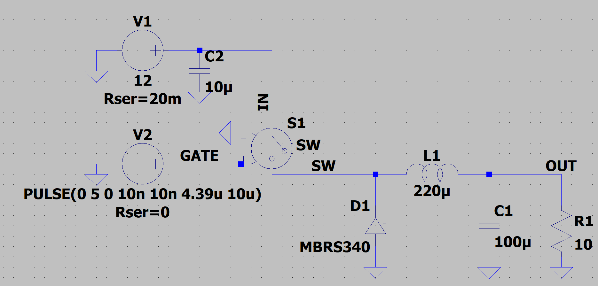
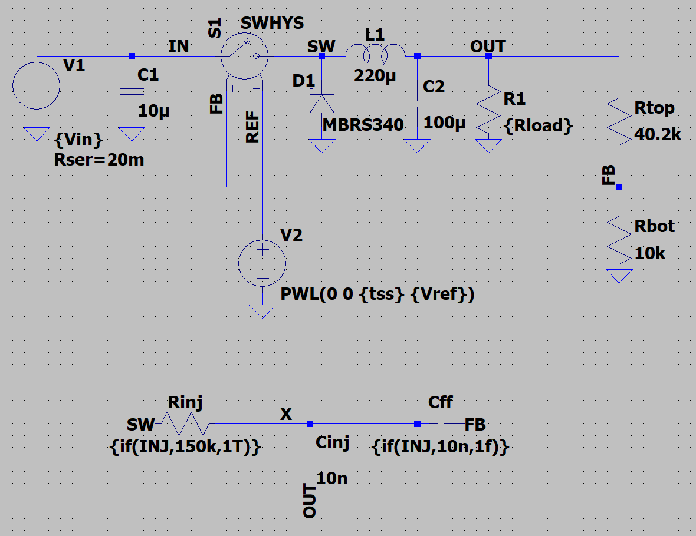
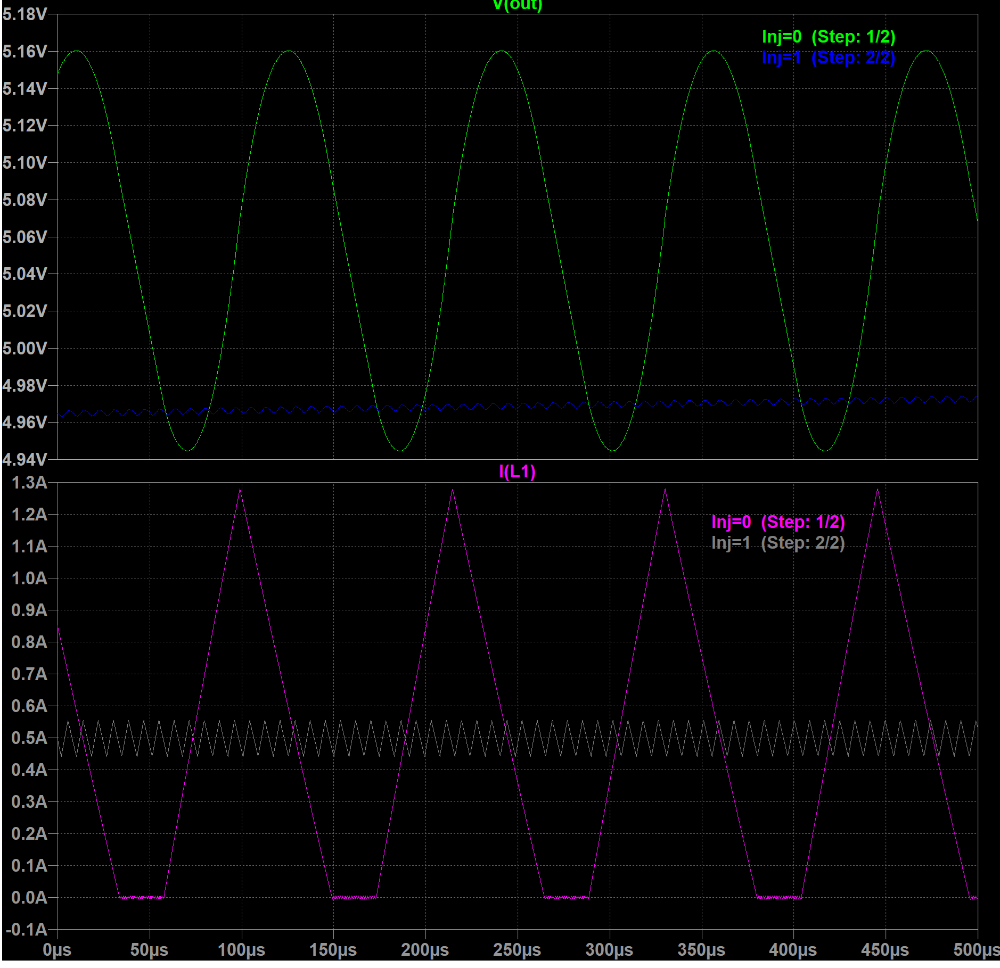
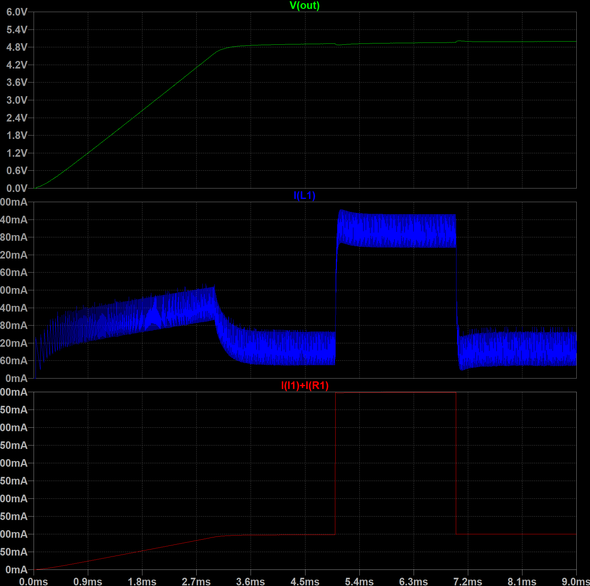
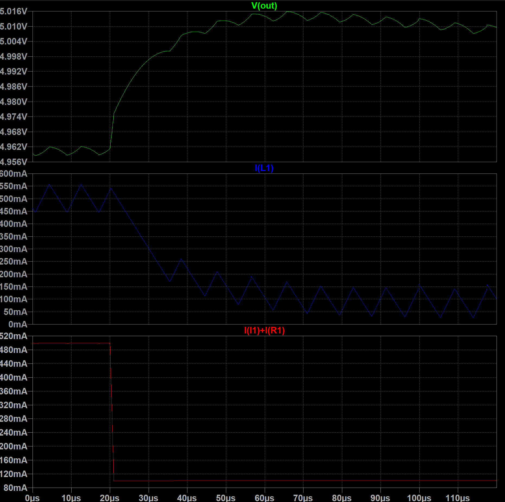

# Bang-Bang Controlled Buck Converter

Design, LTspice simulation, and PCB implementation of a closed-loop nonsynchronous buck converter using **bang-bang (hysteretic) voltage control** with **ripple injection**.

This project was created to put into practice and further develop the power electronics knowledge I have gained throughout my professional career. Starting from first principles, I designed the buck converter power stage, implemented a hysteretic feedback controller, and verified it in LTspice. The next step is to build and test a PCB to compare real hardware against simulation.

The main objective is to demonstrate how a simple nonlinear controller can regulate the output voltage **without an error amplifier, compensation network, PWM ramp, or fixed-frequency PWM modulator**.

---

## 1. Project Objectives

- Design a DC-DC buck converter from first principles
- Calculate the required inductor and capacitors
- Simulate the power stage in LTspice
- Understand MOSFET, diode, inductor, and capacitor behavior
- Implement a bang-bang / hysteretic controller
- Define upper and lower switching thresholds
- Observe the resulting variable switching frequency
- Evaluate startup, load-transient, and input-voltage-transient behavior
- Analyze component losses and converter efficiency
- Design, assemble, and test a PCB prototype
- Compare calculated, simulated, and measured results

---

## 2. Design Requirements

| Parameter | Requirement |
|---|---:|
| Input voltage range | 10–14 V |
| Nominal input voltage | 12 V |
| Nominal output voltage | 5.0 V |
| Output current | 0.1–0.5 A |
| Maximum output power | 2.5 W |
| Control method | Bang-bang / hysteretic with ripple injection |
| Lower switching threshold | 4.95 V |
| Upper switching threshold | 5.05 V |
| Hysteresis window | 100 mV |
| Nominal output ripple target | ≤ 100 mV |
| Topology | Nonsynchronous buck |
| Target efficiency | > 85% |

The controller regulates the output inside the hysteresis window:

$$
4.95\ \text{V} \le V_{OUT} \le 5.05\ \text{V}
$$

Unlike a conventional fixed-frequency PWM controller, **switching frequency is not specified as a control requirement**. It is an outcome of the power stage, load, input voltage, and hysteresis window.

---

## 3. Control Principle

The controller uses two output-voltage thresholds:

$$
V_{LOW} = 4.95\ \text{V}
$$

$$
V_{HIGH} = 5.05\ \text{V}
$$

The basic switching law is:

```text
if VOUT < 4.95 V:
    MOSFET = ON

if VOUT > 5.05 V:
    MOSFET = OFF

otherwise:
    keep previous MOSFET state
```

The difference between the two thresholds creates hysteresis:

$$
V_{HYS} = V_{HIGH} - V_{LOW} = 5.05 - 4.95 = 100\ \text{mV}
$$

The output therefore oscillates around approximately 5 V.

---

## 4. Converter Architecture

```text
                      POWER STAGE

VIN ── MOSFET ── SW ── Inductor ───── VOUT
                 │                      │
               Diode                 Capacitor
                 │                      │
                GND                   Load
                                        │
                                       GND


                     CONTROL LOOP

     VREF (soft-start ramp)        VOUT ── Divider ──┐
              │                                       │
              │              SW ── Ripple injection ──┤
              │                                       │
              └──────► Hysteretic Comparator ◄── FB ──┘
                               │
                               ▼
                         Gate Driver
                               │
                               ▼
                            MOSFET
```

This is considerably simpler than the voltage-mode PWM architecture:

```text
Voltage-mode PWM:

VOUT → Divider → Error Amp → Compensation → PWM Comparator → Driver


Bang-bang:

VOUT → Divider (+ ripple injection) → Hysteretic Comparator → Driver
```

The simplicity of the control loop is one of the main reasons for selecting this control method for the project.

---

## 5. Power Stage

| Component | Selected value / part |
|---|---|
| Input voltage | 10–14 V |
| Nominal input | 12 V |
| Output voltage | ≈ 5 V |
| Output current | 0.1–0.5 A |
| Inductor | 220 µH, DCR ≤ 0.3 Ω, I<sub>sat</sub> ≥ 1 A |
| Output capacitor | 100 µF, low ESR (≈ 30 mΩ) |
| Input capacitor | 10 µF ceramic, 25 V |
| Diode | MBRS340 Schottky (40 V, 3 A) |
| High-side switch (ideal simulation) | Voltage-controlled switch, R<sub>on</sub> = 15 mΩ |
| High-side switch (PCB) | P-channel MOSFET, ≥ 30 V, V<sub>GS(max)</sub> ≥ ±20 V |
| Full-load resistance | 10 Ω |

These values were inherited from the initial open-loop buck design. Because the bang-bang controller does not enforce a fixed switching frequency, **L, C, hysteresis, and ripple injection** were evaluated together through simulation.

> The PCB uses a P-channel MOSFET because it can be driven from ground with a single NPN transistor. A high-side N-channel MOSFET would need a bootstrap gate driver.

### 5.1 Load Resistance

$$
R_{LOAD} = \frac{V_{OUT}}{I_{OUT}}
$$

| Load condition | Current | Resistance | Output power |
|---|---:|---:|---:|
| Full load | 0.5 A | 10 Ω | 2.5 W |
| Half load | 0.25 A | 20 Ω | 1.25 W |
| Light load | 0.1 A | 50 Ω | 0.5 W |

### 5.2 Open-Loop Design Values (12 V, 10 Ω)

| Quantity | Equation | Calculated |
|---|---|---:|
| Duty cycle | $D = \frac{V_{OUT} + V_D}{V_{IN} + V_D}$ | 44.0% |
| Inductor ripple | $\Delta I_L = \frac{(V_{OUT} + V_D)(1 - D)}{L\, f_{SW}}$ | 140 mA<sub>pp</sub> |
| I<sub>L,min</sub> / I<sub>L,peak</sub> | $I_{OUT} \mp \Delta I_L / 2$ | 0.430 / 0.570 A |
| Output ripple | $\Delta V_C + \Delta I_L \cdot ESR$ | < 7 mV<sub>pp</sub> |
| SW low level | $-V_D$ | ≈ −0.5 V |

---

## 6. Bang-Bang Controller

The controller determines the MOSFET state directly from the feedback voltage.

### MOSFET ON

When $V_{OUT} < V_{LOW}$, the MOSFET turns ON. Inductor current increases and energy is transferred from the input supply to the load and output capacitor.

### MOSFET OFF

When $V_{OUT} > V_{HIGH}$, the MOSFET turns OFF. The inductor current freewheels through the Schottky diode and begins decreasing.

### Hysteresis region

When $V_{LOW} < V_{OUT} < V_{HIGH}$, the comparator retains its previous state. This prevents rapid switching around a single reference voltage.

### 6.1 Feedback Divider

$$
V_{FB} = V_{OUT} \times \frac{R_{BOT}}{R_{TOP} + R_{BOT}}
$$

With $R_{TOP} = 40.2\ \text{k}\Omega$ and $R_{BOT} = 10\ \text{k}\Omega$, $V_{FB} \approx V_{OUT}/5$.

A 100 mV window at $V_{OUT}$ is therefore a 20 mV window at FB (0.99–1.01 V).

### 6.2 Reference (VREF) and Soft-Start

The reference sets the regulation target: the comparator switches based on $V_{REF} - V_{FB}$, so $V_{REF} = 1.0\ \text{V}$ gives $V_{OUT} = 5.0\ \text{V}$.

The reference also provides **soft-start**. If $V_{REF}$ were 1 V at power-up, the switch would stay fully on until $V_{OUT}$ reached 5 V, and the LC charging current could reach several amps. Ramping the reference from 0 to 1 V over a few milliseconds makes $V_{OUT}$ follow a slowly rising target and keeps the startup inductor current close to its steady-state value.

| Implementation | Reference |
|---|---|
| Simulation | PWL source, 0 → 1.0 V in 3 ms |
| PCB | 2.5 V shunt reference with soft-start capacitor on the reference node, divided to ≈ 1.0 V |

> The soft-start capacitor goes on the 2.5 V reference node, not on the comparator IN+ pin. A capacitor on IN+ would absorb the hysteresis feedback.

### 6.3 Ripple Injection

With a 100 µF low-ESR output capacitor, $V_{OUT}$ lags the inductor current. After the switch turns off, the inductor keeps charging the capacitor, so $V_{OUT}$ overshoots the threshold. The ESR ripple (≈ 0.14 A × 30 mΩ ≈ 4 mV) is too small compared with the 100 mV window to help.

A ripple-injection network fixes this by feeding a signal that follows the inductor current into FB:

```text
SW ── Rinj 150 kΩ ── X ── Cinj 10 nF ── OUT
                     │
                   Cff 10 nF
                     │
                     FB
```

| Part | Value | Function |
|---|---:|---|
| R<sub>inj</sub> | 150 kΩ | Converts the inductor voltage ($V_{SW} - V_{OUT}$) into a current |
| C<sub>inj</sub> | 10 nF | Integrates it into a triangle that follows $I_L$ |
| C<sub>ff</sub> | 10 nF | AC-couples the triangle into FB |

Design checks:

$$
\tau = R_{inj} C_{inj} = 1.5\ \text{ms} \gg T_{SW} \approx 10\ \mu\text{s}
$$

$$
\Delta V_{inj} \approx \frac{(V_{IN} - V_{OUT})\, t_{ON}}{R_{inj} C_{inj}} = \frac{7 \times 4.4\ \mu\text{s}}{1.5\ \text{ms}} \approx 20\ \text{mV}_{pp}
$$

$$
f_c = \frac{1}{2\pi \,(R_{TOP} \parallel R_{BOT})\, C_{ff}} \approx 2\ \text{kHz} \ll f_{SW}
$$

The injected triangle (~20 mV<sub>pp</sub>) matches the ±10 mV hysteresis at FB, so the comparator switches on a fast, in-phase signal. The trade-off is a small DC offset at $V_{OUT}$, which can be trimmed with $R_{TOP}$.

### 6.4 Hysteresis Network (PCB)

FB connects to the comparator inverting input (IN−). The non-inverting input (IN+) is driven by a reference divider, with positive feedback from the comparator output.

| Element | Value |
|---|---|
| Reference | 2.5 V shunt reference (LM4040-2.5) |
| Reference divider | R<sub>A</sub> = 2.49 kΩ (top), R<sub>B</sub> = 1.65 kΩ (bottom) → ≈ 0.996 V |
| Thevenin resistance | R<sub>TH</sub> ≈ 1 kΩ |
| Hysteresis resistor | R<sub>H</sub> = 249 kΩ, comparator output → IN+ |

With a 0–5 V push-pull comparator output:

$$
\Delta V_{IN+} = 5\ \text{V} \cdot \frac{R_{TH}}{R_{TH} + R_H} \approx 20\ \text{mV}
$$

This places the thresholds at about **4.95 V and 5.05 V** at $V_{OUT}$.

> With an open-collector comparator, the pull-up resistor adds to R<sub>H</sub> and the network must be recalculated. If R<sub>H</sub> is changed for the hysteresis study, R<sub>inj</sub> may need to be adjusted to keep the injected ripple similar in size to the window.

### 6.5 Gate Driver (PCB)

- Comparator output high → NPN (MMBT3904) pulls the PMOS gate low → PMOS ON
- ~1 kΩ gate pull-up to VIN turns the PMOS OFF
- Optional NPN/PNP (MMBT3904/MMBT3906) emitter follower for faster switching
- If the selected PMOS is rated only ±12 V V<sub>GS</sub>, add a 12 V Zener from gate to source

---

## 7. Expected Waveforms

The project analyzes four main signals.

### Output voltage

```text
5.05 V       /¯¯\      /¯¯\
            /    \    /    \
5.00 V ----/------\--/------\----
          /        \/        \
4.95 V
```

### MOSFET gate

```text
ON     ┌──────┐        ┌──────┐
       │      │        │      │
OFF ───┘      └────────┘      └──
```

### Switching node

```text
VIN     ┌──────┐        ┌──────┐
        │      │        │      │
0 V  ───┘      └────────┘      └──
```

During diode conduction, the switching node falls slightly below ground by approximately the diode forward voltage.

### Inductor current

```text
        /\        /\        /\
       /  \      /  \      /  \
      /    \    /    \    /    \
─────/      \──/      \──/      \──
```

The key behavior to observe is:

**VOUT falls → MOSFET ON → IL rises → VOUT rises → MOSFET OFF → IL falls → VOUT falls → repeat**

---

## 8. Variable-Frequency Operation

A major characteristic of bang-bang control is that the switching frequency is **not fixed**:

$$
f_{SW} = f(V_{IN}, V_{OUT}, I_{OUT}, L, C, V_{HYS}, R_{inj} C_{inj})
$$

Changing any of the following can change the switching frequency:

- Input voltage
- Load current
- Inductance
- Output capacitance
- Hysteresis window
- Ripple-injection amplitude
- Component ESR
- Propagation delay

| Test | Expected observation |
|---|---|
| Increase VIN | Higher switching frequency (steeper injected ramp) |
| Increase load | Switching frequency/duty behavior changes |
| Increase COUT | Slower VOUT movement |
| Increase hysteresis | Larger ripple, lower switching frequency |
| Decrease hysteresis | Smaller ripple, higher switching frequency |
| Remove ripple injection | Low, irregular switching frequency and large ripple |

---

## 9. Simulation Results

All simulations were run in LTspice. The results matched the design calculations.

| File | Purpose |
|---|---|
| `01_open_loop.asc` | Fixed 44% duty cycle, power-stage verification |
| `02_bang_bang_ideal.asc` | Ideal hysteretic switch, with and without ripple injection |
| `03_load_transient.asc` | 0.1 → 0.5 → 0.1 A load step |
| `04_line_transient.asc` | 10 → 14 → 10 V input step |
| `05_real_components.asc` | PCB-level circuit: PMOS, BJT gate driver, comparator, reference, delays |

### 9.1 Open-Loop Power Stage (12 V, 10 Ω, D = 44%)

The power stage was first verified with a fixed 100 kHz, 44% duty-cycle gate signal driving an ideal voltage-controlled switch (R<sub>on</sub> = 15 mΩ). No feedback is applied.




| Quantity | Calculated | Simulated | Error |
|---|---:|---:|---:|
| Switching period / duty cycle | 10 µs / 44.0% | 10 µs / 44% | — |
| Average V<sub>OUT</sub> | ≈ 5.0 V | 4.956 V | −0.9% |
| Output ripple | < 7 mV<sub>pp</sub> | ≈ 4.1 mV<sub>pp</sub> | ✅ within target |
| I<sub>L,min</sub> | 0.430 A | 0.427 A | −0.7% |
| I<sub>L,peak</sub> | 0.570 A | 0.564 A | −1.1% |
| Inductor ripple | 140 mA<sub>pp</sub> | ≈ 137 mA<sub>pp</sub> | −2% |
| Average I<sub>L</sub> | 0.50 A | ≈ 0.495 A | −1% |
| SW low level | ≈ −0.5 V | ≈ −0.35 V | Lower diode drop than assumed |
| Operating mode | CCM | CCM | ✅ |
| Efficiency | ≈ 90% | _from Error Log_ | |

**Observations:**

- **Inductor current:** The simulated ripple and current limits agree with the hand calculations within ~2%, and the inductor current never reaches zero, confirming CCM operation.
- **Volt-second balance:** The rising slope (~137 mA in 4.4 µs) corresponds to ≈ 6.8 V across the inductor ($V_{IN} - V_{OUT}$), and the falling slope (~137 mA in 5.6 µs) to ≈ 5.4 V ($V_{OUT} + V_D$).
- **Output ripple:** The ripple shows sharp corners at each switching edge, which indicates it is dominated by the output-capacitor ESR (0.137 A × 30 mΩ ≈ 4.1 mV) rather than by the capacitance (≈ 1.7 mV).
- **Switching node:** During the off-time, SW is clamped to about −0.35 V by the MBRS340, slightly less negative than the 0.5 V assumed in the design.
- **Output voltage:** The average output is ~0.9% below 5 V because the switch resistance, inductor DCR, and source resistance are not compensated in open loop. This steady-state error motivates the feedback controller.

### 9.2 Bang-Bang Controller: Effect of Ripple Injection (12 V, 10 Ω)

The ideal hysteretic controller (±10 mV at FB, ±50 mV at V<sub>OUT</sub>) was simulated with and without the ripple-injection network using `.step param INJ list 0 1`.








| Quantity | Without injection | With injection |
|---|---:|---:|
| V<sub>OUT</sub> range | 4.945–5.160 V | 4.965–4.972 V |
| Average V<sub>OUT</sub> | ≈ 5.05 V | ≈ 4.97 V |
| Output ripple | ≈ 215 mV<sub>pp</sub> | ≈ 5 mV<sub>pp</sub> |
| Switching frequency | ≈ 8.7 kHz | ≈ 105 kHz |
| I<sub>L,min</sub> / I<sub>L,peak</sub> | 0 / 1.28 A | 0.45 / 0.555 A |
| Inductor ripple | 1.28 A<sub>pp</sub> | ≈ 105 mA<sub>pp</sub> |
| Startup V<sub>OUT</sub> peak | _x V_ | _x V_ |
| Startup I<sub>L</sub> peak | _x A_ | _x A_ |
| Operating mode | DCM | CCM |

**Observations:**

- **Without injection:** The output overshoots both thresholds, with a ripple of ~215 mV<sub>pp</sub>, more than twice the 100 mV window. The low-ESR output capacitor delays the feedback, so the inductor keeps charging it after the switch turns off. The converter switches at only ~8.7 kHz, and the inductor current swings from 0 to 1.28 A, entering DCM for ~25 µs every cycle and exceeding the 1 A saturation rating.
- **With injection:** The injected triangle at FB makes the comparator switch on a fast, in-phase signal. The converter runs at ~105 kHz in CCM with an inductor current of 0.45–0.555 A, close to the open-loop design (Section 9.1).
- **Ripple:** The output ripple drops to ~5 mV<sub>pp</sub>, well below the 100 mV hysteresis window. Switching is now set by the injected ripple at FB rather than by V<sub>OUT</sub>, so the output only shows the small ESR ripple.
- **DC offset:** The average output settles at ~4.97 V (−0.6%), within the 4.95–5.05 V band. The small offset comes from the injected ripple and can be trimmed with R<sub>TOP</sub>

### 9.3 Load Transient (12 V, 0.1 → 0.5 → 0.1 A)







| Quantity | Load step (0.1 → 0.5 A) | Load release (0.5 → 0.1 A) |
|---|---:|---:|
| Instant ESR jump | ≈ −14 mV | ≈ +14 mV |
| Peak deviation | ≈ −50 mV (−1.0%) | ≈ +55 mV (+1.1%) |
| Time to peak deviation | ≈ 45 µs | ≈ 45 µs |
| I<sub>L</sub> slew rate (calculated / simulated) | 32 / ≈ 30 mA/µs | 24 / ≈ 24 mA/µs |
| Time for I<sub>L</sub> to reach new load | ≈ 40 µs | ≈ 45 µs |
| Operating mode after step | CCM | CCM (I<sub>L,min</sub> ≈ 30 mA) |
| Steady-state V<sub>OUT</sub> shift (0.1 A ↔ 0.5 A) | ≈ 50 mV (≈ 1%) | |

**Observations:**

- **Immediate response:** At the load edge, V<sub>OUT</sub> jumps by ≈ 14 mV, which matches ΔI × ESR (0.4 A × 30 mΩ = 12 mV).
- **Inductor slew:** I<sub>L</sub> ramps at ≈ 30 mA/µs on the step and ≈ 24 mA/µs on the release, matching (V<sub>IN</sub> − V<sub>OUT</sub>)/L and (V<sub>OUT</sub> + V<sub>D</sub>)/L. The response is limited by the inductor, not by a loop bandwidth.
- **Peak deviation:** It is ≈ ±50 mV (≈ 1%), well inside the 10% transient target. It is slightly larger than the hand estimate because the controller keeps switching during the transient instead of holding the switch fully on or off, so I<sub>L</sub> rises in steps.
- **Load regulation:** V<sub>OUT</sub> settles ≈ 50 mV lower at 0.5 A than at 0.1 A. This comes from the ripple-injection offset, which depends on the operating point.
- **Settling:** After the inductor current reaches the new load, V<sub>OUT</sub> drifts slowly towardt (R<sub>inj</sub>·C<sub>inj</sub> = 1.5 ms). Final settling and recovery time will be measured with a longer simulation window.

### 9.4 Line Transient (10 → 14 → 10 V, 0.5 A)

The line-transient response was evaluated by stepping the input voltage from 10 V to 14 V and back to 10 V while maintaining a constant 10 Ω load and keeping ripple injection enabled.

<br>


<br>

| Quantity | 10 V | 14 V |
|---|---:|---:|
| Average V<sub>OUT</sub> | ≈ 5.00 V | ≈ 5.02 V |
| Switching frequency | TBD | TBD |
| I<sub>L,min</sub> | ≈ 0.445 A | ≈ 0.447 A |
| I<sub>L,peak</sub> | ≈ 0.555 A | ≈ 0.558 A |
| Inductor ripple | ≈ 110 mA<sub>pp</sub> | ≈ 111 mA<sub>pp</sub> |

**Observations:**

- **Line regulation:** V<sub>OUT</sub> remains close to 5 V while V<sub>IN</sub> changes between 10 V and 14 V, demonstrating closed-loop rejection of input-voltage variations.
- **Inductor current:** The average inductor current remains approximately 0.5 A because the load is held constant at 10 Ω. The converter remains in CCM throughout the test.
- **Inductor-current slope:** Increasing V<sub>IN</sub> increases the positive current slope according to `(V_IN − V_OUT)/L`. The controller compensates by changing the switching behavior rather than allowing V<sub>OUT</sub> to follow V<sub>IN</sub>.
- **Output-voltage shift:** A small operating-point shift is visible between the 10 V and 14 V conditions. This is consistent with the operating-point dependence of the ripple-injection network.
- **Regulation range:** Across the complete 10–14 V input-voltage range, V<sub>OUT</sub> remains approximately within 4.99–5.03 V in the simulated waveform.

### 9.5 PCB-Level Circuit (12 V, 10 Ω)


| Quantity | Result |
|---|---:|
| Average V<sub>OUT</sub> | _x V_ |
| Output ripple | _x mV<sub>pp</sub>_ |
| Switching frequency | _x kHz_ |
| Minimum V<sub>GS</sub> | _x V_ |
| Efficiency | _x %_ |

> The PCB-level simulation uses generic PMOS, comparator, and reference models. It will be rerun with the vendor models of the selected parts before the PCB is ordered.

---

## 10. Hardware Prototype (PCB)

A 2-layer PCB will be designed in KiCad to validate the LTspice results on real hardware.

### 10.1 Hardware Architecture

```text
VIN (10–14 V) ──┬── LDO (5 V) ── powers comparator + reference
                │
                ├── P-MOSFET (high side) ── SW ── 220 µH ──┬── VOUT ── Load
                │        ▲                  │  │           │
                │     Gate driver        Schottky│        100 µF
                │     (NPN level shift)     │  └─ Rinj/Cinj/Cff ─► FB
                │        ▲                 GND             │
                │        │                                GND
                │   Comparator ◄── FB (VOUT ÷ 5 + injected ripple)
                │        ▲
                │   Reference (soft-start) + hysteresis network
```

| Block | Implementation |
|---|---|
| High-side switch | P-channel MOSFET (≥ 30 V, no bootstrap needed) |
| Gate driver | NPN level shifter with gate pull-up to VIN |
| Controller | Fast push-pull comparator with resistive hysteresis |
| Reference | 2.5 V shunt reference, divided to ≈ 1.0 V |
| Soft-start | Capacitor on the 2.5 V reference node |
| Feedback | 40.2 kΩ / 10 kΩ divider (VOUT ÷ 5) |
| Ripple injection | 150 kΩ / 10 nF (≥ 25 V) / 10 nF, R<sub>inj</sub> removable |
| Controller supply | 5 V LDO from VIN |
| Rectifier | 40 V, 3 A Schottky |

### 10.2 Startup Protection

- **Soft-start:** reference ramp of a few milliseconds, so $V_{OUT}$ follows a slowly rising target
- **Current sense:** 0.1 Ω sense resistor with a test point, to measure inductor current and allow a future current limit
- **Bench supply:** first power-up with a current-limited supply (~0.3 A)

### 10.3 Test Features

- Test points: VIN, VOUT, SW, GATE, FB, comparator output, GND
- Ground springs or loops for scope probes
- Current-sense resistor / wire loop for inductor current measurement
- Removable R<sub>inj</sub> to test the converter with and without ripple injection
- Selectable hysteresis resistor (50 / 100 / 200 mV windows)
- Screw terminals for VIN and external load
- Onboard 10 Ω, 3 W load with jumper
- LED indicator on VOUT

### 10.4 Layout Guidelines

| Area | Guideline |
|---|---|
| Hot loop | C<sub>IN</sub>, MOSFET, and Schottky as close as possible, short wide traces |
| SW node | Small copper area, kept away from FB |
| Ripple injection | R<sub>inj</sub> close to SW; short X-node and C<sub>ff</sub> traces into FB |
| Ground | Solid bottom ground plane; power and signal ground joined near C<sub>OUT</sub> |
| FB trace | Short, Kelvin-sensed from the C<sub>OUT</sub> pad, divider next to the comparator |
| Comparator | 100 nF decoupling directly at the supply pin |
| Board | 2-layer, 1 oz copper, ~50 × 50 mm, 0805 or larger passives |

### 10.5 Bring-Up Procedure

1. **Controller only:** MOSFET not populated; check the 5 V rail, reference, soft-start ramp, and comparator thresholds by sweeping a voltage into FB
2. **First power-up:** full board at 10 V, 0.3 A current limit, 50 Ω load
3. **Check waveforms:** GATE, SW, and VOUT on the oscilloscope
4. **Increase stress:** step to 12 V and 14 V, then to the 10 Ω load
5. **Run tests:** load step, line step, with/without injection, hysteresis sweep, and efficiency

---

## 11. Development Plan

### Phase 1: Requirements
- [x] Define input-voltage range
- [x] Define nominal output voltage
- [x] Define load-current range
- [x] Define hysteresis window
- [x] Define efficiency target

### Phase 2: Power Stage
- [x] Calculate load resistance
- [x] Select initial inductor
- [x] Select output capacitor
- [x] Select input capacitor
- [x] Select diode
- [x] Select MOSFET

### Phase 3: Open-Loop Simulation
- [x] Build buck power stage in LTspice
- [x] Apply fixed-duty-cycle gate signal
- [x] Verify switching-node voltage
- [x] Verify inductor current
- [x] Verify output voltage
- [x] Compare calculated and simulated values

### Phase 4: Bang-Bang Controller
- [x] Remove fixed PWM source
- [x] Implement hysteretic comparator
- [x] Set thresholds to 4.95 V / 5.05 V
- [x] Add soft-start reference
- [x] Add ripple-injection network
- [x] Verify autonomous switching
- [x] Verify output regulation

### Phase 5: Operating-Point Analysis
- [x] Measure average output voltage
- [x] Measure output ripple
- [x] Measure switching frequency
- [x] Measure inductor-current ripple
- [x] Compare operation with and without ripple injection

### Phase 6: Load Transients
- [x] Apply 0.1 A → 0.5 A load step
- [x] Measure voltage undershoot
- [x] Measure recovery time
- [x] Apply 0.5 A → 0.1 A load release
- [x] Measure voltage overshoot

### Phase 7: Line Transients
- [x] Apply 10 V → 14 V input step
- [x] Measure output disturbance
- [x] Verify recovery
- [x] Apply 14 V → 10 V step
- [x] Measure output disturbance

### Phase 8: Hysteresis Study
- [ ] Test 50 mV window
- [ ] Test 100 mV window
- [ ] Test 200 mV window
- [ ] Compare output ripple
- [ ] Compare switching frequency
- [ ] Compare transient response

### Phase 9: Real Components
- [x] Build PCB-level circuit (PMOS, BJT gate driver, comparator, reference)
- [x] Use Schottky diode model
- [x] Add inductor DCR
- [x] Add capacitor ESR
- [x] Add comparator propagation delay
- [x] Add soft-start and verify startup current
- [ ] Replace generic models with vendor models of the selected parts
- [ ] Evaluate switching-node ringing

### Phase 10: Efficiency (Simulation)
- [x] Calculate input power
- [x] Calculate output power
- [x] Calculate efficiency
- [ ] Sweep efficiency versus load
- [ ] Identify dominant losses

### Phase 11: PCB Design
- [ ] Select final PMOS, comparator, reference, and LDO
- [ ] Draw the schematic in KiCad
- [ ] Lay out the PCB
- [ ] Review layout against Section 10.4
- [ ] Generate Gerbers and BOM
- [ ] Order the PCB and components

### Phase 12: Hardware Bring-Up and Testing
- [ ] Assemble the board
- [ ] Verify the controller with no power stage
- [ ] First power-up with a current-limited supply
- [ ] Measure switching waveforms
- [ ] Test with and without ripple injection
- [ ] Run load, line, and hysteresis tests
- [ ] Measure efficiency
- [ ] Compare hardware results with simulation

---

## 12. Verification Plan

Each test is performed in simulation and will be repeated on the PCB.

| Test | VIN | Load | Verification |
|---|---:|---:|---|
| Open loop | 12 V | 0.5 A | Power-stage ripple and current limits |
| Nominal | 12 V | 0.5 A | Output regulation |
| Light load | 12 V | 0.1 A | Regulation / switching behavior |
| Minimum VIN | 10 V | 0.5 A | Regulation |
| Maximum VIN | 14 V | 0.5 A | Regulation |
| Startup | 12 V | 0.5 A | Overshoot and inrush current |
| Load step | 12 V | 0.1 → 0.5 A | Undershoot / recovery |
| Load release | 12 V | 0.5 → 0.1 A | Overshoot / recovery |
| Line step | 10 → 14 V | 0.5 A | Regulation |
| Ripple injection | 12 V | 0.5 A | With vs. without injection |
| Hysteresis sweep | 12 V | 0.5 A | Ripple vs. frequency |
| Full load | 12 V | 0.5 A | Efficiency |

---

## 13. Key Measurements

| Measurement | Symbol |
|---|---|
| Average output voltage | $V_{OUT,AVG}$ |
| Output ripple | $\Delta V_{OUT}$ |
| Average switching frequency | $f_{SW,AVG}$ |
| Inductor peak current | $I_{L,PK}$ |
| Inductor minimum current | $I_{L,MIN}$ |
| Input power | $P_{IN}$ |
| Output power | $P_{OUT}$ |
| Efficiency | $\eta$ |

Because switching frequency varies with time, it is measured over 20 switching cycles rather than from a single period.

---

## 14. Efficiency

Efficiency is calculated as:

$$
\eta = \frac{P_{OUT}}{P_{IN}} \times 100\%
$$

Target: **η > 85%** at:

- $V_{IN} = 12$ V
- $V_{OUT} \approx 5$ V
- $I_{OUT} = 0.5$ A

Expected major losses:

- Schottky diode conduction
- Inductor DCR
- MOSFET conduction
- MOSFET switching
- Gate-drive and controller losses

---

## 15. Repository Structure

```text
bang-bang-buck-converter/
│
├── README.md
├── .gitignore
│
├── LTSPICE/
│   ├── 01_open_loop.asc
│   ├── 02_bang_bang_ideal.asc
│   ├── 03_load_transient.asc
│   ├── 04_line_transient.asc
│   └── 05_real_components.asc
│
├── calculations/
│   ├── power_stage_design.md
│   ├── hysteresis_network.md
│   └── ripple_injection.md
│
├── hardware/
│   ├── kicad/
│   ├── gerbers/
│   ├── bom.csv
│   └── photos/
│
├── results/
│   ├── simulation/
│   │   ├── 01_Schematic.png
│   │   ├── 01_Waveforms.png
│   │   ├── 02_schematic.png
│   │   ├── 02_injection_comparison.png
│   │   ├── 03_load_transient.png
│   │   ├── 04_line_transient.png
│   │   ├── 05_schematic.png
│   │   └── 05_waveforms.png
│   └── hardware/
│       ├── scope_captures/
│       └── efficiency.png
│
└── docs/
    └── final_report.pdf
```

---

## 16. Tools

- LTspice
- KiCad
- GitHub
- Oscilloscope, current-limited bench supply, electronic load
- Analytical power-electronics calculations

---

## 17. Project Status

**Current stage: Component selection and PCB design (Phase 11)**

Simulation is complete. The open-loop power stage matches the hand calculations within ~2%.

Next steps:

1. Add the remaining simulation results (Sections 9.2–9.5)
2. Run the hysteresis sweep (50 / 100 / 200 mV) in simulation
3. Select the final PMOS, comparator, reference, and LDO
4. Rerun the PCB-level simulation with vendor models at 10/12/14 V and 10/50 Ω
5. Confirm startup inductor current stays below the inductor I<sub>sat</sub>
6. Draw the schematic and lay out the PCB in KiCad
7. Order, assemble, and test the board

---

## 18. Lessons Learned

### Open loop cannot correct for losses

With a fixed 44% duty cycle, the open-loop converter settled at 4.956 V instead of 5.0 V. The duty cycle was calculated with only the diode drop included, so the switch resistance, inductor DCR, and source resistance produced an uncorrected ~0.9% error. In a real converter, the error would also change with input voltage, load, and temperature. This is the fundamental reason for closing the loop.

### Output ripple is dominated by ESR, not capacitance

The open-loop output ripple (~4.1 mV<sub>pp</sub>) matched the ESR contribution (0.137 A × 30 mΩ) much more closely than the capacitive contribution (~1.7 mV). This also explains why ripple injection is needed: the ESR ripple at the output is far too small to drive a 100 mV hysteresis window.

### Ripple injection was required for stable hysteretic operation

With pure output-voltage hysteresis, the 100 µF low-ESR output capacitor delayed the feedback signal. The converter switched at only a few kHz, the output ripple was much larger than the 100 mV window, and the inductor current dropped to zero each cycle with peaks above the inductor saturation rating.

Adding an R<sub>inj</sub>/C<sub>inj</sub>/C<sub>ff</sub> network (150 kΩ / 10 nF / 10 nF) injected a triangle that follows the inductor current into FB. This restored ~100 kHz CCM operation and reduced the ripple to tens of mV. The injected ripple adds a small DC offset at the output, which can be trimmed with the feedback divider.

### Soft-start is essential with voltage-only feedback

Without a ramped reference, the switch stays fully on at power-up until $V_{OUT}$ reaches the upper threshold. The LC charging current can reach several amps, causing inductor saturation and large overshoot. Ramping the reference over a few milliseconds keeps startup current close to its steady-state value.

### Open topics

The following trade-offs will be documented as the project continues:

- Hysteresis width vs. ripple and switching frequency
- Transient response
- Component parasitics and PCB layout
- Comparator and gate-driver delay
- Simulation vs. hardware differences

The project will also compare the simplicity of bang-bang control with the more structured but more complex approach of conventional fixed-frequency voltage-mode PWM control.
